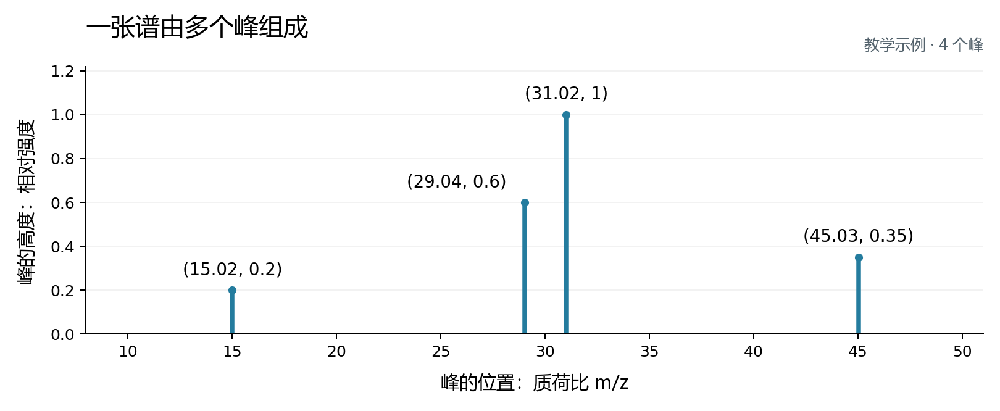

# 从一张质谱到一个分子

这次大作业要做的事是：**读入仪器测到的数字，为每个未知分子列出最可能的化学结构。** 你可以从“在已知样本中找相似对象”入手，再运用数据处理、向量表示和排序方法改善结果。

下面先讲清这些数字来自哪里，再看文件里怎样存、程序怎样用。操作命令和作业安排见 [README](README.md)。

## 1. 我们到底在猜什么

咖啡中的咖啡因、水果中的有机酸，都属于小分子。研究人员分析植物等生物样品时，会遇到大量分子，希望知道它们分别是什么，以便研究它们的性质和作用。

一个分子由原子连接而成。**本题要预测的“结构”，就是有哪些原子，以及它们怎样连接。** 可以把它理解为一张图：原子是节点，化学键是连接节点的边。

为了让程序保存和提交这张图，比赛使用一种叫 **SMILES** 的文本表示。例如：

| SMILES | 怎样读 | 对应结构 |
| --- | --- | --- |
| `CCO` | 两个碳原子接着一个氧原子 | 乙醇 |
| `COC` | 一个氧原子连接两个碳原子 | 二甲醚 |

这里 `C` 表示碳，`O` 表示氧，许多氢原子按规则省略。两种分子都有两个碳、一个氧，却因连接方式不同而具有不同性质。这也解释了为什么知道分子的质量之后，还需要更多线索来确定结构。

在这个项目中，你会经常看到 SMILES 字符串。先把它当作程序读写分子结构的方式，就可以开始实验。

## 2. 仪器怎样把分子变成数字

质谱仪测量带电的粒子，也就是**离子**。本题中的串联质谱测量，可以按下面的顺序理解：

1. **让分子带电。** 例如，分子获得一个质子，形成 `[M+H]+`。其中 `M` 代表原来的分子，`+` 表示带正电。
2. **选中一种离子，测量它的质荷比。** 这个准备被打碎的离子叫“前体离子”。质荷比写作 `m/z`，可以理解为离子的质量除以电荷数的大小。
3. **通过碰撞让它碎裂。** 仪器记录碎片离子的质荷比，以及各位置的信号强度。把这些记录画出来，就是一张质谱。

多数入门例子中的离子只带一个电荷，此时 `m/z` 在数值上接近离子的质量。不同分子的连接方式会影响碎裂结果，因此这些碎片提供了识别结构的线索。[竞赛背景介绍](https://www.kaggle.com/competitions/enveda-CASMI26-molecule-id-mass-spectra/overview)

### 一张谱应该怎么看

用下面这组简化的教学数据贯穿后面的例子：

```text
峰的位置： [15.02, 29.04, 31.02, 45.03]
峰的强度： [ 0.20,  0.60,  1.00,  0.35]
```

两个列表按位置一一对应：第一个峰位于 `15.02`，强度为 `0.20`；第二个峰位于 `29.04`，强度为 `0.60`，依此类推。它们共同描述**一张含有 4 个峰的谱**。



横轴告诉我们峰在哪里，纵轴告诉我们信号有多强。这里最高的峰位于 `31.02`，把它的强度记为 `1.00`，其他峰按比例表示。`0.60` 就表示该峰的强度是最高峰的 60%。

同一种分子在不同碰撞能量或带电形式下，可能产生不同的谱。可以把这些谱看作同一对象在不同测量条件下留下的多份线索，预测时把它们合起来使用。

## 3. 下载的三个文件分别装了什么

数据位于项目的 `data/raw/` 目录。

| 文件 | 里面是什么 | 你用它做什么 |
| --- | --- | --- |
| `train.parquet` | 质谱、测量条件，以及对应的正确结构 | 学习谱与结构的关系；本项目先用它建立参考谱库 |
| `test.parquet` | 待识别分子的质谱、测量条件和编号 | 让程序为每个分子生成候选结构 |
| `sample_submission.csv` | 一份符合要求的提交文件示例 | 查看最终答案的列名和写法 |

**Parquet 可以理解为适合程序读取的表格文件。** 和普通表格一样，它有行和列；它还方便保存列表，所以一格里可以放一整组峰的位置。CSV 则是用逗号分隔各列的文本表格，适合保存最终答案。

训练文件中，**一行是一张谱**。同一个结构可能出现多行，因为它有多次测量。测试文件也按谱存储，再通过 `molecule_id` 把属于同一分子的行联系起来。

当前公开的 `test.parquet` 是供大家跑通程序的示例。Kaggle 正式评分时会换上隐藏的测试数据，再运行你提交的代码。本地比较方法时，我们从带答案的训练数据里另划一部分做验证。[官方数据说明](https://www.kaggle.com/competitions/enveda-CASMI26-molecule-id-mass-spectra/data)

## 4. 怎样读懂表格中的一行

先看谱本身，再看测量条件，最后看编号或答案。

### 谱和测量条件

| 列名 | 一格里装什么 | 对应的含义 |
| --- | --- | --- |
| `ms2_mzs` | 数字列表，如 `[15.02, 29.04, 31.02, 45.03]` | 各个峰的位置 |
| `ms2_normalized_intensities` | 数字列表，如 `[0.20, 0.60, 1.00, 0.35]` | 与上面每个峰对应的相对强度 |
| `precursor_mz` | 一个数，如 `47.049` | 碎裂前的前体离子质荷比，帮助缩小候选范围 |
| `adduct` | 字符串，如 `[M+H]+` | 分子以什么形式带电，会影响前体质荷比 |
| `ionization_mode` | `positive` 或 `negative` | 正离子或负离子测量模式 |
| `collision_energy_ev` | 能量列表，如 `[20.0]`，也可能缺失 | 碰撞时使用的能量；一个记录可以包含多个能量值 |

名称中的 `ms2` 对应碎裂后的这一级质谱测量。最常用的输入就是前两列：**位置数组和强度数组，合起来是一张谱。** 其他列补充这张谱是在什么条件下测到的。

### 训练数据中的答案

| 列名 | 含义 | 基线怎样使用 |
| --- | --- | --- |
| `normalized_smiles` | 已知分子的结构字符串 | 找到相似参考谱后，取出它对应的结构作为候选 |
| `inchikey14` | 用来归并结构的标识字符串 | 将同一结构的多张参考谱合并，避免候选列表重复出现同一结构 |

可以把训练记录理解为“这张谱的正确答案是这个结构”。程序从这些有答案的记录中学习或检索，再对未知分子给出预测。项目代码读取的字段可在 [preprocess.py](algorithms/baseline/preprocess.py) 中找到。

### 测试数据中的编号

测试文件用 `molecule_id` 表示待识别的分子，用 `spectrum_id` 区分它的各张谱。例如：

| molecule_id | spectrum_id | 含义 |
| --- | --- | --- |
| `demo_01` | `demo_01_s1` | 第一个分子的第一张谱 |
| `demo_01` | `demo_01_s2` | 第一个分子的第二张谱 |
| `demo_02` | `demo_02_s1` | 第二个分子的第一张谱 |

这张表有 **3 行谱，对应 2 个分子**。预测时把前两行的线索合起来，为 `demo_01` 给出一个候选列表；第三行为 `demo_02` 提供线索。

原始训练文件用结构标签归并记录；课程的验证脚本会给抽出的查询数据生成 `molecule_id`，让它也能按同样的流程做预测。

## 5. 程序最终要交出什么

对每个分子，程序给出最多 25 个候选结构，按可能性从高到低排列。下面是一份简化的输出示例：

```csv
molecule_id,smiles
demo_01,COC;CCO
demo_02,CC(=O)O;CCO
```

逗号把“分子编号”和“候选列表”分开，分号把同一个分子的不同候选分开。因此第一行预测的意思是：对于 `demo_01`，程序首先猜 `COC`，其次猜 `CCO`。

假设 `demo_01` 的正确结构是 `CCO`，它排在第 2 位，这个分子得 `1/2 = 0.5` 分。比赛使用 **MRR@25**：先计算每个分子的正确答案排名倒数，再取平均。

| 分子 | 正确答案的位置 | 该分子的得分 |
| --- | --- | --- |
| A | 第 1 位 | 1 |
| B | 第 2 位 | 0.5 |
| C | 前 25 个候选中未出现 | 0 |

这三个分子的平均得分为 `(1 + 0.5 + 0) / 3 = 0.5`。所以改进有两个方向：**让正确结构进入候选列表，以及让它排得更靠前。** 官方按结构判断答案是否匹配；本地入门脚本先按字符串相等计算近似分数。[官方评价与提交格式](https://www.kaggle.com/competitions/enveda-CASMI26-molecule-id-mass-spectra/overview)

## 6. 课程基线怎样完成这件事

基线把训练数据当作一本“已知结构的谱图册”。拿到未知谱后，它寻找最相似的参考谱，并返回参考谱对应的结构。

```text
带答案的训练谱 ──→ 参考谱库
                       ↑ 检索相似谱
待识别分子的多张谱 ──→ 各张谱的候选 ──→ 合并排序 ──→ 每个分子的一行答案
```

这里有四个具体步骤：

1. **把谱变成向量。** 将横轴切成固定宽度的小格，每个格子汇总落入其中的峰强度，叫作“分箱”。例如宽度为 1 时，`31.02` 和 `31.80` 都落入 `[31, 32)`。所有谱都按同一组格子表示，就能逐项比较。代码默认先对强度开平方，再分箱并归一化。
2. **筛选可比较的参考谱。** 优先选择带电形式和离子模式相同、前体质荷比接近的记录，让比较集中在更可能的候选上。
3. **计算相似度。** 用余弦相似度比较向量：两张谱在相同位置都有较强的峰，通常会得到较高的相似度。基线据此给参考结构排序。
4. **合并到分子。** 同一结构可能有多张参考谱，一个未知分子也可能有多张查询谱。默认基线为每个候选结构保留最高相似度，再取前 25 个候选，写入一行答案。

参考库决定能找回哪些结构，相似度和合并方式决定它们的排序。因此，扩大参考库、调整分箱宽度、改变强度变换，都有明确的实验意义。对应代码在 [retrieval.py](algorithms/baseline/retrieval.py)。

README 中的四条命令，就是把这条思路依次落实为：**抽一小份训练谱 → 留出有答案的查询谱 → 运行检索 → 对照答案评分**。

## 7. 亲手看一张谱

按 README 生成 `data/processed/reference_sample.parquet` 后，在激活课程环境的 Python 或 Notebook 中运行：

```python
import pandas as pd

# 读入已经抽取的小样本，每行是一张参考谱。
spectra = pd.read_parquet("data/processed/reference_sample.parquet")
row = spectra.iloc[0]  # 取第一行

print("这张谱对应的结构：", row["normalized_smiles"])
print("前体质荷比：", row["precursor_mz"])
print("带电形式：", row["adduct"])
print("峰的数量：", len(row["ms2_mzs"]))

# 将两个数组按位置配对，查看前五个峰。
peaks = list(zip(row["ms2_mzs"], row["ms2_normalized_intensities"]))
print("前五个峰的位置与强度：", peaks[:5])
```

再回到项目根目录的终端，把同一行画成图：

```text
python -m data.scripts.plot_spectrum --file data/processed/reference_sample.parquet --row 0 --out outputs/data_review/spectrum.png
```

打开 `outputs/data_review/spectrum.png`，找到最高的峰，再到两个数组中找到它的位置和强度。这样，文件中的一行、两个数字列表和一张质谱图就对应起来了。
