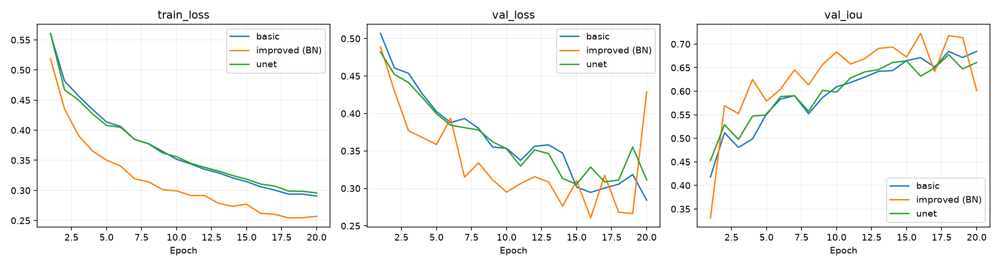
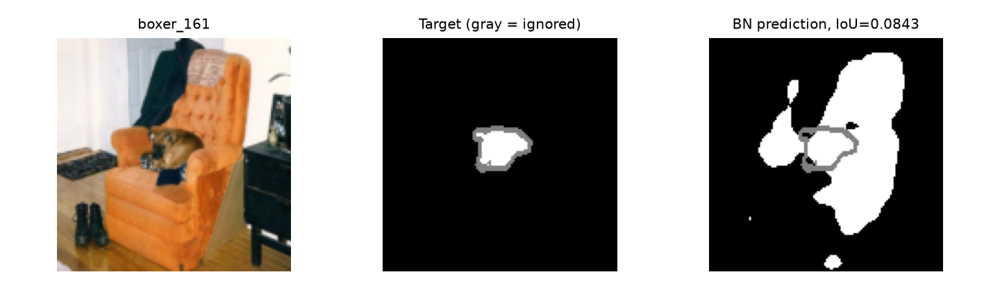
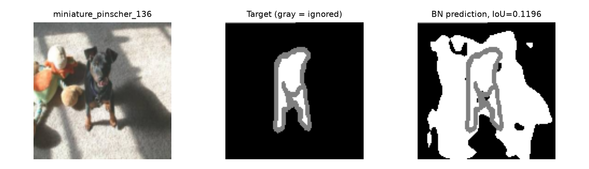
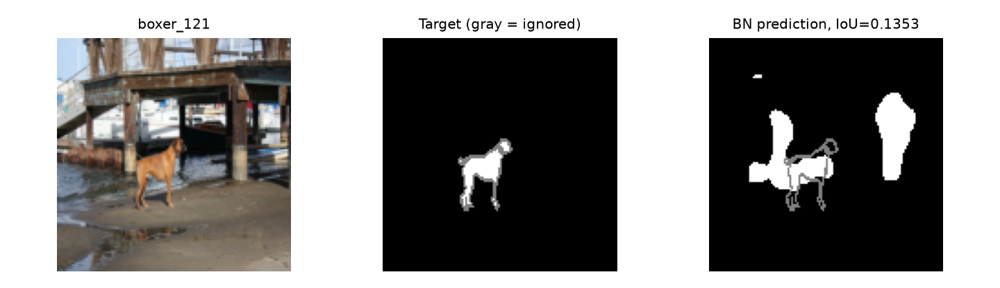
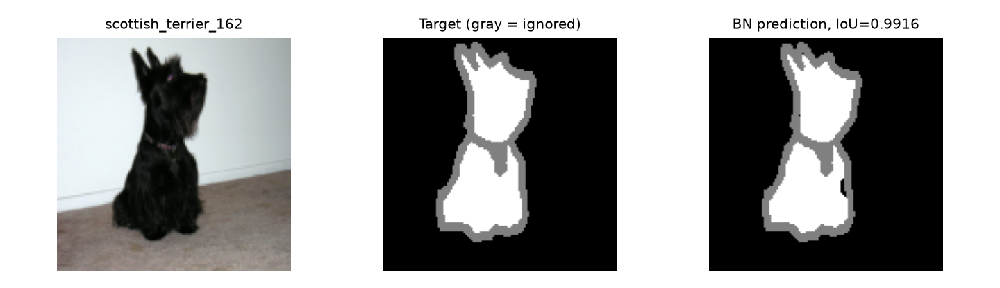
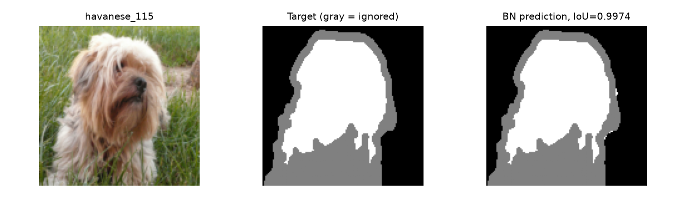
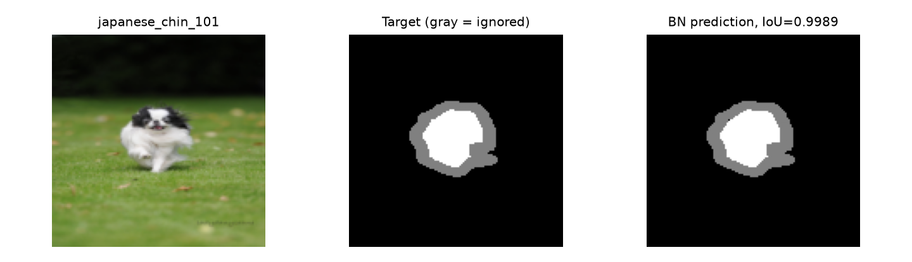

# 实验05：宠物主体分割

从基础卷积编解码器到 BN 改进与小型 U-Net

| 项目         | 内容                                                              |
| ------------ | ----------------------------------------------------------------- |
| 课程 / 单位  | 人工智能数学原理与算法 B / 中国科学技术大学人工智能与数据科学学院 |
| 姓名 / 学号  | 吴炳睿 / PB24081512                                              |
| 实验记录日期 | 基础训练：2026-10-20；BN、U-Net及最终测试：2026-11-02             |
| 运行方式     | 本地 NVIDIA GPU；未使用107平台，Slurm作业编号不适用               |
| 环境         | Python 3.11.17；PyTorch 2.7.1+cu128；NVIDIA GeForce RTX 5080      |

**实验概述** 本实验在 Oxford-IIIT Pet 固定划分上完成逐像素二分类，比较基础编解码器、首阶段加入 BN 的改进版与带两条跳跃连接的小型 U-Net。在相同20轮训练预算下，三组最佳验证 IoU 分别为0.684446、0.722655、0.677494。根据验证集选择 BN 改进版第16轮，完整3669张测试图上的平均前景 IoU 为0.731225，Dice 为0.829054。U-Net在本次设置下未超过基线，报告保留这一实际结果。

## 1. 数据与基本运算

### 1.1 标注转换与固定划分

图像为 RGB 宠物照片，输入缩放为128×128。三值 trimap 转为二值训练目标，并单独保存有效区域掩码。

| 原始值 | 含义       | target    | valid | 是否参与损失与指标 |
| ------ | ---------- | --------- | ----- | ------------------ |
| 1      | 宠物前景   | 1         | 1     | 是                 |
| 2      | 背景       | 0         | 1     | 是                 |
| 3      | 不确定边界 | 0（占位） | 0     | 否                 |

边界标注存在不确定性，将其强行作为背景会引入错误监督。因此代码用 valid=0 排除这些位置；target=0 仅用于占位。图像用双线性插值缩放，标签用最近邻插值，避免生成非法类别编号。若使用水平翻转，应同步变换图像与标签；本次三组均未开启增强。

保留官方测试集；在官方 trainval 名单内按品种分组，以划分种子2026生成训练2941张、验证739张、测试3669张。训练初始化和打乱顺序的种子为42，与划分种子用途不同。固定划分防止训练、模型选择和最终测试相互混用。

划分指纹（下面两行直接连接）：

```text
37cee4018bbc0efe2e7652fdab3d5e0ceca
b3a4e62bb015eaea61530d4fa3770
```

<!-- pagebreak -->

### 1.2 卷积、激活与池化手算

卷积练习采用不翻转卷积核的互相关，步长1、无填充、偏置0。输入和卷积核为：

```text
X = [1 2 3]       K = [ 1  0]
    [4 5 6]           [ 0 -1]
    [7 8 9]
```

四个窗口依次得到：左上1-5=-4，右上2-6=-4，左下4-8=-4，右下5-9=-4。因此输出为 `[[-4,-4],[-4,-4]]`。`correlate2d` 用两层循环截取窗口，逐元素相乘求和；窗口位置变化，但使用同一个核，体现局部连接与权重共享。

将中心5改为10后，输出变为 `[[-9,-4],[-4,1]]`。中心像素在四个窗口中对应的核权重依次为-1、0、0、1，所以只有左上减少5、右下增加5，其余两个输出不变。

ReLU逐元素计算 max(0,x)，不改变形状。原卷积输出经过ReLU全为0；修改后的输出经过ReLU为 `[[0,0],[0,1]]`。它引入非线性，但负值被截断，不能由输出恢复全部原值。

```text
A = [1 3 2 0]       2x2 max-pool, stride=2
    [4 2 1 5]        -> [4 5]
    [0 6 3 1]           [6 4]
    [2 1 4 2]
```

四个池化窗口的最大值分别为max(1,3,4,2)=4、max(2,0,1,5)=5、max(0,6,2,1)=6、max(3,1,4,2)=4。池化对各通道独立执行，通道数不变，高宽减半，没有可训练参数，但丢失窗口内多数数值及精确位置。

## 2. 编码器、解码器与连接

### 2.1 尺寸和参数计算

卷积输出尺寸为 floor((H+2p-k)/s)+1；含偏置的参数量为 C_out×(C_in×k×k+1)。3×3、步长1、填充1的卷积保持高宽；2×2、步长2池化将高宽减半。例如16到32通道卷积有32×(16×9+1)=4,640个参数。表中省略批量维B，k/s/p表示核大小/步长/填充。

| 阶段           | 输入 C×H×W             | 卷积k/s/p；操作      | 输出 C×H×W | 参数量 |
| -------------- | ------------------------ | -------------------- | ------------ | ------ |
| stage1         | 3×128×128              | 3/1/1；ReLU；池化2/2 | 16×64×64   | 448    |
| stage2         | 16×64×64               | 3/1/1；ReLU；池化2/2 | 32×32×32   | 4,640  |
| stage3         | 32×32×32               | 3/1/1；ReLU；池化2/2 | 64×16×16   | 18,496 |
| decoder.block2 | 64×32×32（已上采样）   | 3/1/1；ReLU          | 32×32×32   | 18,464 |
| decoder.block1 | 32×64×64（已上采样）   | 3/1/1；ReLU          | 16×64×64   | 4,624  |
| decoder.block0 | 16×128×128（已上采样） | 3/1/1；ReLU          | 16×128×128 | 2,320  |
| decoder.output | 16×128×128             | 1/1/0                | 1×128×128  | 17     |

<!-- pagebreak -->

### 2.2 网络接口与 BN 改进

编码器依次返回e1、e2和z，形状分别为 `[B,16,64,64]`、`[B,32,32,32]`、`[B,64,16,16]`。基础模型只将z送入解码器。三次双线性插值逐步恢复到128×128，插值不改变通道数，后续卷积学习空间特征变换。保留二维空间结构，使每个输出像素仍与图像位置对应；Flatten会破坏当前卷积解码接口。

BN改进版仅将第一阶段改为 Conv2d(3,16) → BatchNorm2d(16) → ReLU → MaxPool2d，其余编码阶段与解码器结构相同。BN为每个通道学习缩放和平移，共增加16+16=32个可训练参数，总参数量为49,041。运行均值与方差是缓冲状态，不计入可训练参数。

BatchNorm2d训练时在B、H、W维度上统计各通道的均值和方差，并更新运行统计；评估时使用运行统计。程序通过train()/eval()切换行为。BN不改变尺寸。本实验没有使用LN；若使用LayerNorm(C)对每个像素的通道归一化，需要先把通道移到最后一维，不能直接作用于NCHW布局的通道轴。

### 2.3 原始得分、损失和评价指标

输出头返回logits z，不添加sigmoid。概率p=1/(1+exp(-z))；p≥0.5等价于z≥0，得到二值预测。训练使用带logits的二元交叉熵，在内部稳定处理sigmoid。

每张图的损失先在有效像素上平均，再对批量平均：单图损失=sum(valid×BCEWithLogits)/max(sum(valid),1)。忽略区域对损失和梯度的贡献为0；全忽略图的损失贡献为0。

在有效区域内，IoU=交集像素数/并集像素数，Dice=2×交集像素数/(预测前景数+真实前景数)。逐图计算后求平均，而非将所有图片的像素先合并计算；双方前景都为空时指标记为1。

### 2.4 自检结果

报告整理时复核了以下检查，输出保存在 `report-assets/checks.log`。基础与改进训练日志也包含原训练前的检查记录。

| 检查命令                   | 核对内容                           | 实测结果            |
| -------------------------- | ---------------------------------- | ------------------- |
| python checks.py operators | 卷积、ReLU、池化及边缘情况         | PASS                |
| python checks.py core      | 三值转换、忽略边界、IoU/Dice及梯度 | PASS                |
| python checks.py basic     | 编解码尺寸、反向传播、参数更新     | PASS；loss=0.693172 |
| python checks.py improved  | BN版接口和一次参数更新             | PASS；loss=0.693421 |
| python checks.py unet      | 两处拼接内容、两分支梯度、完整更新 | PASS；loss=0.693469 |

检查使用2张随机128×128输入，最终输出均为 `[2,1,128,128]`。上述loss是自检合成目标的损失，用于验证程序行为，不代表真实宠物数据的分割成绩。

<!-- pagebreak -->

## 3. 训练与复现

### 3.1 控制变量与运行配置

三组共用固定划分、128×128输入、masked_loss与逐图指标，均训练20轮、批量16、学习率0.001、种子42，使用Adam默认其余参数，workers=0，不开启增强。训练2941张、验证739张，没有截取子集，三组partial_run均为false。CUDA使用确定性cuDNN设置并关闭benchmark，但单次运行仍不足以评价随机波动。

每个批次按train()、清空梯度、前向传播、损失计算、backward()、optimizer.step()执行。每轮在eval()及无梯度模式下验证，只保存验证IoU严格提高时的权重，因此同分保留更早轮次。测试集仅用于验证集选定模型后的最终评估。

### 3.2 实际训练与评估命令

以下命令在实验目录的 `code/` 中执行；本机解释器为 `D:/SoftWare/MiniConda/envs/ustcaib/python.exe`。三组采用上述相同默认预算。

```bash
python run_local.py basic --output outputs/basic-local-01
python run_local.py improved --output outputs/improved-local-02
python run_local.py unet --output outputs/unet-local-01
python run_local.py evaluate \
  --checkpoint outputs/improved-local-02/best.pt \
  --output outputs/final-test-01
```

命令分行使用Linux风格反斜杠，仅便于阅读；在PowerShell中执行时合并为一行。已有输出目录不能覆盖，复跑需换新目录。`improved-local-01`是未加入实际结构改动的早期运行，不作为本报告的改进组。

### 3.3 权重与代码快照恢复

每组输出目录保存run.json、history.csv、curves.png、validation_examples.png、best.pt、splits.json及source/。run.json记录参数量、环境、设备、预算、划分指纹和最佳轮次；source/保存训练时全部Python源码，包含U-Net新增文件。

评估应运行同一训练目录的source/evaluate.py，并加载同目录的best.pt。模型根据权重中的config重建，再恢复model_state；读取数据时检查划分指纹相同。这样可避免当前工作区代码变化导致模型结构不匹配。

```bash
python outputs/unet-local-01/source/evaluate.py \
  --checkpoint outputs/unet-local-01/best.pt \
  --data-dir data --device cuda --split val \
  --output outputs/unet-val-01
```

基础版、BN版及U-Net均通过快照在739张验证图上重新评估，所得指标与各自最佳轮次记录一致。BN复核目录为improved-val-report-01；自检日志、案例清单和报告插图另存于report-assets/，不替代原始训练记录。

<!-- pagebreak -->

## 4. 改进对比与错误分析

### 4.1 同预算对照结果

Dice取自最佳验证IoU所在轮次，而非单独挑选Dice最高轮次。三组均为20轮、batch=16、lr=0.001；耗时为各次实际运行的墙钟时间。

| 模型 / 主要改动      | 参数量 | 最佳轮次 | 验证IoU  | 对应Dice | 耗时/秒 |
| -------------------- | ------ | -------- | -------- | -------- | ------- |
| 基础版 / 无          | 49,009 | 20       | 0.684446 | 0.797661 | 174.61  |
| 改进版 / 首阶段BN    | 49,041 | 16       | 0.722655 | 0.825147 | 246.99  |
| U-Net / 两条拼接连接 | 60,529 | 18       | 0.677494 | 0.790934 | 168.53  |



BN组相对基础版最佳验证IoU提高0.038209，即约3.82个百分点，增加参数仅32个，因此选其第16轮作为最终模型。BN组第20轮验证IoU回落到0.601373，尽管训练损失仍较低；这说明不能只看最后一轮或训练损失，也不能把BN理解为每轮必然更稳定。

U-Net训练损失从0.5608下降到0.2958，基础版末轮为0.2906；U-Net最佳验证IoU低于基础版0.006952，约0.70个百分点。在本次20轮、单种子设置下，增加跳跃连接未带来整体指标提升。更长训练或其他种子可能改变结果，但本报告未开展这些额外实验。

U-Net比基础版增加11,520个参数，约23.5%，同时改变连接路径和融合卷积容量。当前对照不能将全部差异归因于连接路径本身。不同运行受缓存、系统负载等影响，耗时不宜直接解释为结构效率排名。单种子结果不具备多次重复实验的统计确定性。

### 4.2 案例选择方法

后两页使用最终BN模型的最佳权重，在验证集逐图IoU中选取真实有效前景非空的最低3张和最高3张。每组均展示原图、真实掩码与预测掩码；白色为前景、黑色为背景、灰色为忽略区域。所有分析在验证集上进行，没有据此调整测试集结果。

另发现Egyptian_Mau_196原图有猫，但原始PNG所有像素均为2（背景）。该异常保留在固定划分与总指标中，单独说明，不充作下页的模型失败案例。图像视觉上“分出了猫”与标注指标之间可能因此不一致。

<!-- pagebreak -->

### 4.3 三个失败案例：小目标、背景与阴影



**boxer_161：IoU=0.0843，Dice=0.1554。**宠物蜷在椅子上，占图比例较小。模型将椅背和椅子附近大片区域识别为前景，形成严重误分。相近颜色及局部纹理可能使宠物与家具混淆；较小前景也使假阳性对IoU影响更明显。



**miniature_pinscher_136：IoU=0.1196，Dice=0.2137。**狗处于强光和阴影交界，周围还有玩具。预测包含大面积背景并漏分部分宠物有效区域，未准确区分主体、阴影与邻近物体。亮度变化可能是干扰因素，单张图不能确定其因果作用。



**boxer_121：IoU=0.1353，Dice=0.2384。**宠物位于码头结构前，主体较小，细腿占像素少。预测中出现与宠物分离的大片白色区域，且腿部覆盖不完整。池化和128×128缩放可能使细部更难保持，复杂背景也增加误分机会。

三例都说明：仅增加BN不能解决小目标定位、背景相似和细肢体恢复问题。后续可分别设计分辨率或数据增强对照，但不应在本次对照中同时改变多个因素。

<!-- pagebreak -->

### 4.4 三个成功案例：主体区域恢复



**scottish_terrier_162：IoU=0.9916，Dice=0.9958。**深色宠物与浅色墙面形成较明显对比，主体占图比例较大。头部和身体有效区域基本完整，未出现类似失败案例中的大片背景误分。少量耳尖与轮廓差异不影响大部分主体覆盖。



**havanese_115：IoU=0.9974，Dice=0.9987。**浅色宠物与草地颜色差异明显，头部及上半身的有效前景与标注高度重合。但图中下方和毛发周围存在较大的忽略区域，高IoU不能证明这些区域或每根毛发都被准确分割。



**japanese_chin_101：IoU=0.9989，Dice=0.9994。**宠物虽较小，但位于相对均匀的草地背景中，主体有效区域被连续检出，背景误分很少。与失败案例对照可见，小目标并非必然失败，前景背景对比与场景结构也会影响预测。

成功案例支持模型已经学到一定的主体与背景区分能力，但这些极端样例不能代替整体均值。由于评估忽略不确定边界，报告将“主体分割成功”与“精确毛发边界恢复”区分开来。

<!-- pagebreak -->

## 5. 最终分割效果

最终模型在测试前依据验证集选定：BN改进版improved-local-02，第16轮。没有通过测试集在三种模型间再次选择。

| 项目         | 最终测试记录                                           |
| ------------ | ------------------------------------------------------ |
| 数据         | Oxford-IIIT Pet官方测试划分，3669张                    |
| 输入 / 阈值  | 128×128 / sigmoid概率≥0.5                            |
| 平均前景IoU  | 0.731225                                               |
| 平均前景Dice | 0.829054                                               |
| 测试损失     | 0.258871                                               |
| 完整性       | split=test；partial_training=false                     |
| 权重         | code/outputs/improved-local-02/best.pt                 |
| 结果         | code/outputs/final-test-01/metrics.json及per_image.csv |

测试数据使用与训练记录相同的划分指纹（见第1节）。指标先在单图有效区域上计算，再平均。测试IoU略高于验证IoU，可能来自两个集合的样本构成差异，不能据此认为模型在测试集上进行了进一步学习。测试过程没有参数更新。

## 6. 进阶选做：小型 U-Net

### 6.1 模型实现与连接

独立文件为code/student_unet.py，模型类SmallUNet复用基础PetEncoder，额外引入两条编码器到解码器的跳跃连接。U-Net没有叠加BN改进，便于将其作为单独结构方案比较。

```text
images -> e1 -> e2 -> z
          |     |    |
          |     |    +-> upsample
          |     +------> concat(64+32) -> conv -> d2
          |                                      |
          |                                  upsample
          +------------> concat(32+16) <----------+
                              |
                            conv -> d1 -> upsample
                                           |
                                      conv -> logits
```

第一次将z上采样到e2的32×32，与e2拼成96通道，再卷积到32通道；第二次将d2上采样到e1的64×64，拼成48通道，再卷积到16通道。最后恢复128×128，用1×1输出头生成单通道原始得分。

上采样显式使用skip.shape[-2:]对齐高宽，拼接维度dim=1。最终返回 `[B,1,128,128]`，沿用原来的损失、阈值与评价协议。

<!-- pagebreak -->

### 6.2 融合尺寸、参数与自检

| 阶段             | 输入 C×H×W            | 输出 C×H×W             | 参数量 |
| ---------------- | ----------------------- | ------------------------ | ------ |
| 编码器三阶段合计 | 3×128×128             | 64×16×16及两组跳跃特征 | 23,584 |
| 第一次通道拼接   | 64×32×32 + 32×32×32 | 96×32×32               | 0      |
| block2           | 96×32×32              | 32×32×32               | 27,680 |
| 第二次通道拼接   | 32×64×64 + 16×64×64 | 48×64×64               | 0      |
| block1           | 48×64×64              | 16×64×64               | 6,928  |
| 上采样及block0   | 16×64×64              | 16×128×128             | 2,320  |
| output           | 16×128×128            | 1×128×128              | 17     |
| 全模型           |                         |                          | 60,529 |

例如block2参数为32×(96×3×3+1)=27,680。编码器各阶段参数和形状见第2节。插值、拼接和ReLU不增加可训练参数。

models.py增加build_model("unet")；train.py和run_local.py增加unet选项；checks.py增加check_unet()。检查不仅确认尺寸，还逐项比较融合输入与原始上采样/跳跃特征，并验证融合输入两部分均有非零梯度，再执行完整模型的一次参数更新。

### 6.3 实验结果与解释

U-Net以相同预算训练20轮，第18轮验证IoU最高，为0.677494，对应Dice为0.790934；快照恢复后验证结果一致。验证集有347/739张图的IoU高于基础版，但整体均值低约0.70个百分点，说明部分图像改善不等于总体收益。

在已有逐图对照中，english_cocker_spaniel_175的IoU由0.9746提升到0.9917，主体内部孔洞减少；Maine_Coon_121由0.9761提升到0.9941，尾部下缘附近覆盖更完整；scottish_terrier_153则由0.1057降到0.0310，深色犬脸大面积漏分。该对照图保存在report-assets/unet-comparison.png。

这组结果与“浅层空间信息可能帮助局部恢复”的机制相容，但不构成总体性能提升的证据。容量、训练预算与随机性都可能影响结果。本报告不为获得更高分而选择性删除失败运行或异常标注。

### 6.4 与 ResNet 残差相加的理论比较

| 比较项     | U-Net通道拼接                  | ResNet残差相加                     |
| ---------- | ------------------------------ | ---------------------------------- |
| 形式       | cat([up,skip],dim=1)           | F(x)+x                             |
| 形状要求   | B、H、W相同，C可不同           | 相加前各维必须匹配                 |
| 输出通道数 | 两支通道数之和                 | 与匹配后的输入相同                 |
| 组合方式   | 两组通道并列保留，再经卷积融合 | 输入与学习到的修正逐元素叠加       |
| 主要作用   | 融合深层语义与较精细的定位信息 | 提供直接传播路径，辅助深层网络优化 |

两个 `[B,32,32,32]` 张量相加后形状不变，拼接后为 `[B,64,32,32]`。若一支为64通道，拼接可直接得到96通道；相加前需通过投影等方式匹配通道与空间尺寸。本实验仅做理论比较，未训练ResNet。

<!-- pagebreak -->

## 7. 总结

### 7.1 实验结论与局限

实验完成了基本运算、三阶段卷积编码器、上采样解码器、BN改进及小型U-Net，且训练权重可通过代码快照恢复。在本次固定划分和20轮预算下，首阶段BN方案取得最高验证IoU，因此被选为最终模型；完整测试IoU为0.731225。U-Net有部分局部改善，但未提高整体验证均值。

池化丢失的信息不能仅靠插值完整恢复。多个不同输入窗口可能具有相同最大值，池化映射不是一一对应；插值只依据低分辨率邻域生成平滑估计，无法唯一推回被丢弃的数值和位置。U-Net通过旁路保留较浅层特征，提供额外信息，但也不能保证恢复全部细节。

当前实验只有一个训练种子，输入缩放可能改变长宽比，忽略边界的评价不能全面反映细毛发质量；小目标、复杂背景和阴影仍是失败来源。若继续研究，应分别改变训练种子、输入分辨率或增强方式，并保持其余条件一致，在验证集上分析后再决定最终方案。

### 7.2 文件与证据索引

下列路径均相对于实验目录:

| 内容                 | 路径                                                              |
| -------------------- | ----------------------------------------------------------------- |
| 基础训练             | code/outputs/basic-local-01/                                      |
| BN改进训练、最终权重 | code/outputs/improved-local-02/                                   |
| U-Net训练与代码快照  | code/outputs/unet-local-01/                                       |
| 完整最终测试         | code/outputs/final-test-01/                                       |
| 三组验证复核         | code/outputs/basic-val-01/、improved-val-report-01/、unet-val-01/ |
| 训练和最终测试日志   | code/logs/                                                        |
| 报告检查与案例清单   | report-assets/checks.log、cases.json                              |
| 图表与报告来源       | report-assets/；report.md                                         |
